# Data Architecture & Persistence Layer

The project defines 41 Prisma models backed by PostgreSQL. Prisma Client is shared by the backend modules, and schema changes are managed through Prisma Migrate.

## Database Configuration

| Service/Module | DB Type | Profile | Driver | Connection | Migration Tool |
|---|---|---|---|---|---|
| Backend | PostgreSQL | One datasource; environment-specific connection values | `pg` through Prisma `adapter-pg` | Read from backend environment; no connection values reproduced here | Prisma Migrate; migrations are under `Backend/prisma/migrations-postgresql` |

No separate per-profile database configuration was found. The API uses the configured runtime database connection; Prisma CLI configuration can use a direct connection for migrations. Connection-pool sizing is not configured in the inspected Prisma service.

## Data Ownership per Service

| Service | Tables Owned | ORM Framework | Caching | Notes |
|---|---|---|---|---|
| Identity | `User`, `RefreshToken`, `Publisher` | Prisma | None identified | Publisher is a profile related one-to-one with `User`; Author is a user role, not a separate table. |
| Content | `Content`, `MangaDetail`, `NovelDetail`, `Chapter`, `ChapterPage`, `ChapterContent`, `Genre`, `Tag`, join tables, `ContentKnowledgeBase` | Prisma | None identified | Publisher, Author, and catalog operations share content tables. |
| Reading | `Bookmark`, `Favorite`, `Rating`, `ReadingProgress`, `ChapterRead`, `ContentPurchase` | Prisma | None identified | Reading and unlock operations also use commerce-owned wallet and purchase data. |
| Community | `Comment`, `Notification`, `Report`, `SupportTicket`, `TicketMessage` | Prisma | None identified | `Report.targetType` and `targetId` form a polymorphic reference without a target foreign key. |
| Commerce | `Wallet`, `PaymentOrder`, `BankTransaction`, `WalletLedger`, `CreatorRevenue`, `PayoutProfile`, `PayoutRequest`, `SystemSetting` | Prisma | None identified | Payment, wallet, revenue, and payout data share the same PostgreSQL database. |
| AI and recommendations | `AIConversation`, `AiChatSession`, `AiChatMessage`, `AiUsageDaily`, `AiUsageEvent`, `AiAdminAuditLog`, `RecommendationCache`, `UserGenrePreference` | Prisma | None identified | `RecommendationCache` is a persisted recommendation table, not evidence of an in-memory or distributed cache. |

Ownership is logical by backend module; the modules use one shared Prisma client and database rather than separate databases.

## Entity Model

The following ER diagram highlights 20 core entities. Join tables for content genres and tags are represented as many-to-many relationships; less central models are described in the ownership table and remain present in `Backend/prisma/schema.prisma`.

```mermaid
erDiagram
    User ||--o| Publisher : "has publisher profile"
    User ||--o{ Content : "uploads"
    Publisher o|--o{ Content : "publishes"
    Content o|--o{ Content : "has translations"
    Content ||--o{ Chapter : "contains"
    Chapter ||--o{ ChapterPage : "contains pages"
    Chapter ||--o| ChapterContent : "has text"
    Content }o--o{ Genre : "classified by"
    Content }o--o{ Tag : "tagged with"
    User ||--o{ Bookmark : "creates"
    Content ||--o{ Bookmark : "is bookmarked"
    User ||--o{ Rating : "writes"
    Content ||--o{ Rating : "receives"
    User ||--o{ Comment : "writes"
    Content ||--o{ Comment : "has comments"
    Comment o|--o{ Comment : "has replies"
    User ||--o{ ReadingProgress : "tracks"
    Content ||--o{ ReadingProgress : "is read"
    Chapter ||--o{ ReadingProgress : "last chapter"
    User ||--o| Wallet : "owns"
    Wallet ||--o{ WalletLedger : "records"
    User ||--o{ WalletLedger : "owns entries"
    User ||--o{ PaymentOrder : "creates"
    PaymentOrder o|--o{ BankTransaction : "matched with"
    User o|--o{ BankTransaction : "processes"
    User ||--o{ ContentPurchase : "buys"
    Content ||--o{ ContentPurchase : "is purchased"
    ContentPurchase ||--o| CreatorRevenue : "generates"
    User ||--o{ CreatorRevenue : "earns"
    Content ||--o{ CreatorRevenue : "earns from"
    User ||--o| PayoutProfile : "sets"
    User ||--o{ PayoutRequest : "requests"
    User o|--o{ PayoutRequest : "processes"

    User {
        string id PK
        string username UK
        string email UK
        string role
        string passwordHash
    }
    Publisher {
        string id PK
        string userId FK
        string organizationName
        string verificationStatus
    }
    Content {
        string id PK
        string uploaderId FK
        string publisherId FK
        string parentContentId FK
        string title
        string type
        string ownershipTier
        string publicationStatus
    }
    Chapter {
        string id PK
        string contentId FK
        int number
        string moderationStatus
    }
    ChapterPage {
        string id PK
        string chapterId FK
        int pageNumber
        string imageUrl
    }
    ChapterContent {
        string id PK
        string chapterId FK
        string textBody
    }
    Genre {
        string id PK
        string name UK
    }
    Tag {
        string id PK
        string name UK
    }
    Bookmark {
        string id PK
        string userId FK
        string contentId FK
        datetime createdAt
    }
    Rating {
        string id PK
        string userId FK
        string contentId FK
        int score
    }
    Comment {
        string id PK
        string userId FK
        string contentId FK
        string parentCommentId FK
        string body
    }
    ReadingProgress {
        string id PK
        string userId FK
        string contentId FK
        string lastChapterId FK
        int lastPageNumber
    }
    Wallet {
        string id PK
        string userId FK
        int balance
    }
    PaymentOrder {
        string id PK
        string userId FK
        int expectedAmount
        int paidCoins
        string transferCode UK
        string status
    }
    BankTransaction {
        string id PK
        string paymentOrderId FK
        string processedById FK
        string externalId UK
        int transferAmount
        string processingStatus
    }
    WalletLedger {
        string id PK
        string walletId FK
        string userId FK
        int amountCoins
        int balanceAfter
    }
    ContentPurchase {
        string id PK
        string userId FK
        string contentId FK
        int priceCoins
        datetime purchasedAt
    }
    CreatorRevenue {
        string id PK
        string creatorId FK
        string purchaseId FK
        string contentId FK
        int creatorCoins
    }
    PayoutProfile {
        string id PK
        string userId FK
        string bankName
        string bankAccountNumber
    }
    PayoutRequest {
        string id PK
        string userId FK
        string processedById FK
        int amountCoins
        string status
    }
```

<!-- mermaid-checked: every attribute is `<type> <name> [<key>] ["<description>"]` with at most one of PK/FK/UK, no \n in descriptions, no {} in descriptions, every relationship label is double-quoted -->

In the full schema, `ContentGenre`, `ContentTag`, and `UserGenrePreference` are composite-key join tables. `MangaDetail` and `NovelDetail` are optional one-to-one extensions of `Content`. Other important composite unique constraints include chapter number per content, page number per chapter, and user-content pairs for bookmarks, favorites, ratings, and purchases.

## Key Repository Methods

There are no separate repository interfaces; feature services query the shared `PrismaService` directly. Examples of notable persistence operations:

| Service | Repository | Notable Methods | Purpose |
|---|---|---|---|
| Content catalog | Prisma Client in `Backend/modules/content/content/content-catalog.service.ts` | `content.findMany`, `genre.findMany`, `tag.findMany`, `contentTag.findMany` | Search/filter content and load catalog associations. |
| Reading progress | Prisma Client in `Backend/modules/reading/reading-progress/reading-progress.service.ts` | `readingProgress.upsert`, `chapterRead.upsert`, `chapterRead.findMany`, `chapterRead.deleteMany` | Persist and query per-user progress and completed chapters. |
| Wallet | Prisma Client in `Backend/modules/commerce/wallet/wallet.service.ts` | `walletLedger.findMany` | Return paginated wallet history. |
| Payment | Prisma Client in `Backend/modules/commerce/payment/payment.service.ts` | `paymentOrder.findFirst`, `systemSetting.upsert`, `systemSetting.findMany` | Retrieve a payment order and persist/read payment settings. |
| Content defaults | Prisma Client in `Backend/modules/content/content/content-defaults-seed.service.ts` | `tag.upsert`, `genre.upsert` | Idempotently seed default tags and genres. |

Transaction boundaries use Prisma `$transaction` in workflows that update related records, including authentication, payment reconciliation, wallet unlocks, and payout operations.

## Caching Strategy

No Redis, in-memory cache provider, or general-purpose cache integration was identified in the inspected backend dependencies and modules. `RecommendationCache` is a PostgreSQL model storing user-content scores and generation timestamps; it should not be confused with a cache provider or TTL-based cache.

## Data Ownership Boundaries

All feature modules share one PostgreSQL database and one Prisma Client service. Module ownership is organizational, not database-enforced isolation. Cross-module operations use direct Prisma queries and transactions rather than service-to-service persistence APIs; for example, reading unlocks coordinate wallet and purchase records in a transaction.

### Data Classification & Sensitivity

| Entity | Sensitive Fields | Classification (PII/PHI/PCI/None) | Controls in Place |
|---|---|---|---|
| `User` | `email`, `username`, `passwordHash` | PII | Password is stored as a hash; no field-level encryption or masking was identified in the schema. |
| `PayoutProfile` | Bank name, account number, account holder name | PII and financial data | No field-level encryption or masking was identified in the schema. |
| `PayoutRequest` | Bank account details and payout owner | PII and financial data | No field-level encryption or masking was identified in the schema. |
| `PaymentOrder` | Bank account details | PII and financial data | No field-level encryption or masking was identified in the schema. |
| `BankTransaction` | Transfer description, destination account, raw provider payload | Financial data; may contain PII | No field-level encryption or masking was identified in the schema. |
| `RefreshToken` | `tokenHash` | Authentication secret material | Token is stored as a hash; expiration and revocation fields are present. |

No payment-card fields were identified in the entity model. Database or storage-level encryption-at-rest configuration is outside the Prisma schema and was not verified here.
